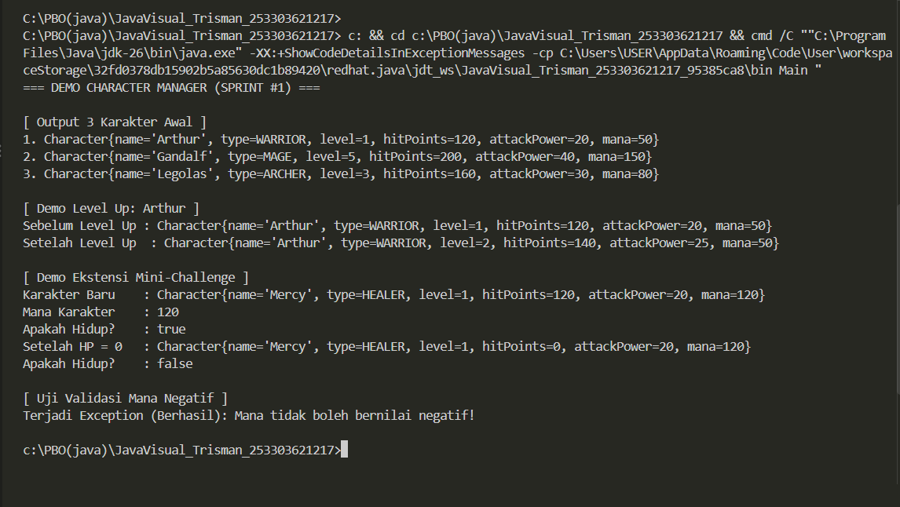

# JavaVisual_TrismanJunnedyEphaproditusGulo_253303621217

# Character Manager — TP3 (Java Visual SIH-6406)

Proyek ini merupakan implementasi fondasi *class model* Java untuk aplikasi **Character Manager** pada Sprint #1. Aplikasi ini dibangun mengimplementasikan konsep dasar Pemrograman Berbasis Objek (OOP) seperti *Encapsulation*, *Type Safety* dengan Enum, *Constructor Overloading*, serta validasi atribut kondisi (*exception handling*).

---

## 📌 Screenshot Output Terminal


---

## 📁 Struktur Folder Project

```text
javavisual-tp03-[NIM]/
├── README.md
└── CharacterManager/
    └── src/
        ├── Main.java
        └── com/
            └── unpri/
                └── charactermanager/
                    └── model/
                        ├── Character.java
                        └── CharacterType.java

```
---

# Character Manager Java Visual TP5

---
Nama: Trisman Junnedy Ephaproditus Gulo
NIM: 253303621217
Kelas: Sistem Informasi / Java Visual (SIH-6406)
Dosen Pengampu: Dr. Evta Indra


---


## Ringkasan Proyek
Proyek ini merupakan pengembangan lanjutan dari modul Character Manager (Sprint #2 / TP5). Fokus utama pengerjaan meliputi penerapan prinsip Pemrograman Berorientasi Objek di Java, validasi data, enkapsulasi memori, serta penanganan koleksi data secara aman.

---

## Struktur dan Implementasi Fitur
1. Core Implementation (Bagian A):
- Character.java: Mengimplementasikan method equals() yang dioverride untuk membandingkan kesamaan nama karakter secara case-insensitive.
- CharacterManager.java: Menyediakan method addCharacter() dengan pencegahan duplikasi nama, findByName(), removeCharacter(), getTotalCharacters(), serta getAllCharacters() yang menerapkan Defensive Copying agar list internal terlindungi dari modifikasi luar.

2. Mini-Challenge (Bagian B):
- getAverageLevel(): Menghitung rata-rata level seluruh karakter secara akurat dan dilengkapi pengaman kondisi list kosong (mencegah error pembagian dengan nol).
- findByType(CharacterType): Menyaring dan mengembalikan daftar karakter berdasarkan tipe tertentu.

3. Fitur Analitik Mandiri (Bagian C):
- renameCharacter(oldName, newName): Method rancangan sendiri untuk mengubah nama karakter dengan validasi ketat terhadap nama kosong dan pencegahan bentrok nama dengan karakter lain yang sudah ada.

## Analisis dan Dokumentasi (Bagian D)
- Tautan Dokumen Analisis Google Docs: https://docs.google.com/document/d/17mQVz4Sup2ySj154_-H6PZ7psDAkIZMqWyOgDwHO_bQ/edit?usp=sharing


## Screenshot Output Program
Output eksekusi program terminal (menampilkan uji CRUD, penolakan duplikat, defensive copying, mini-challenge, rename, hingga eksperimen reference) telah diuji dan berjalan dengan sukses tanpa kendala.
