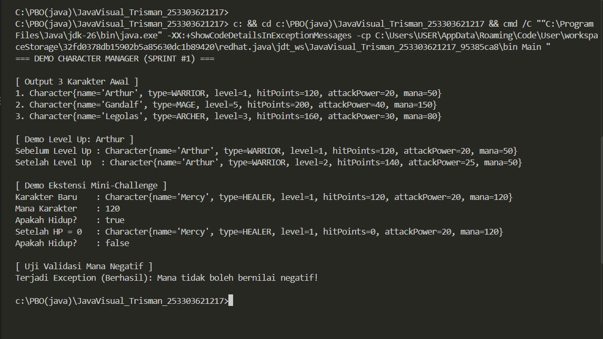
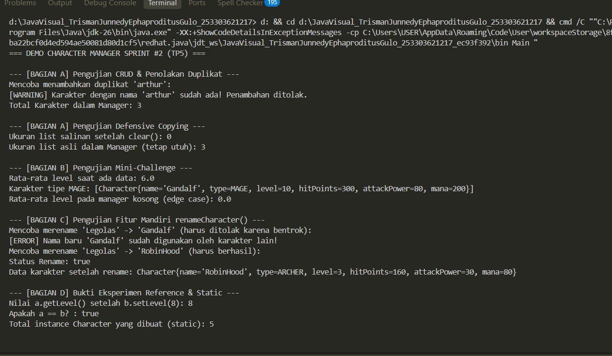
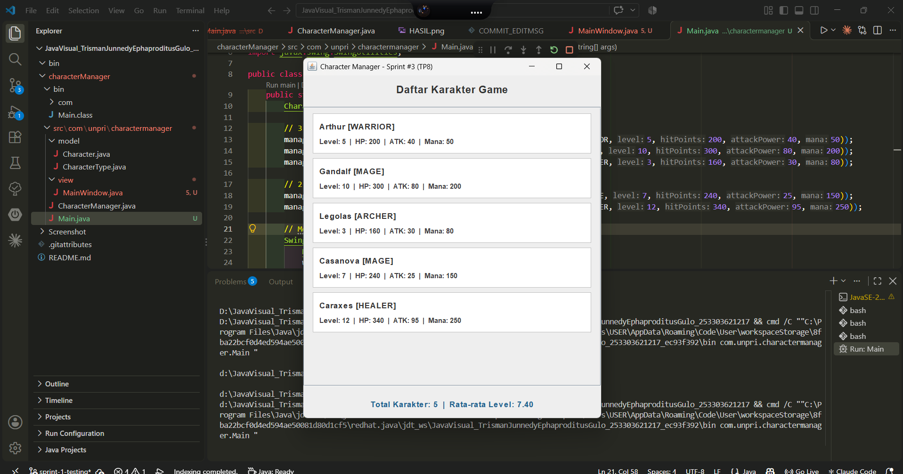
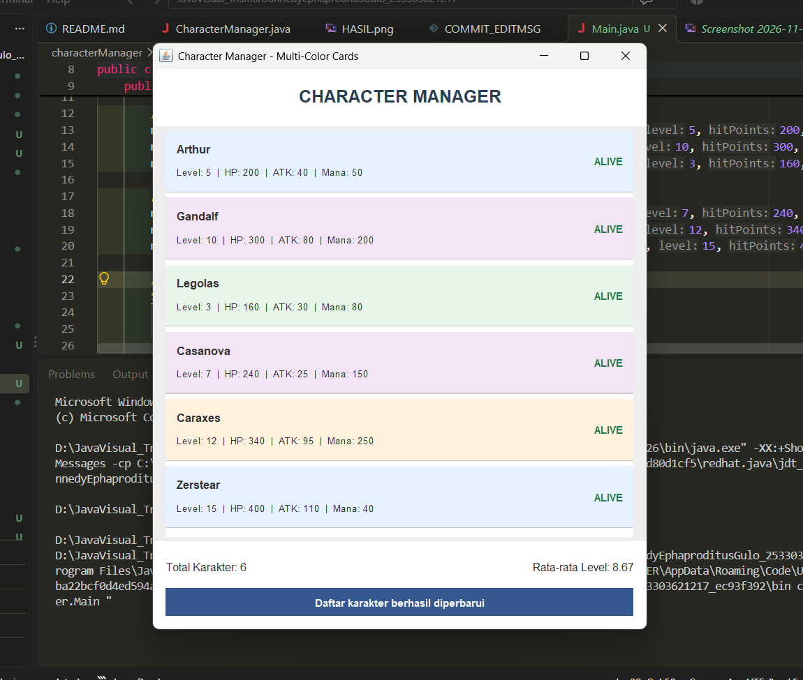
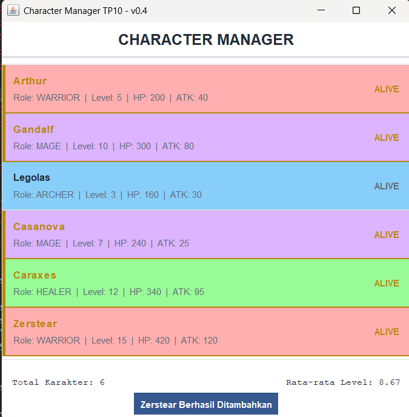
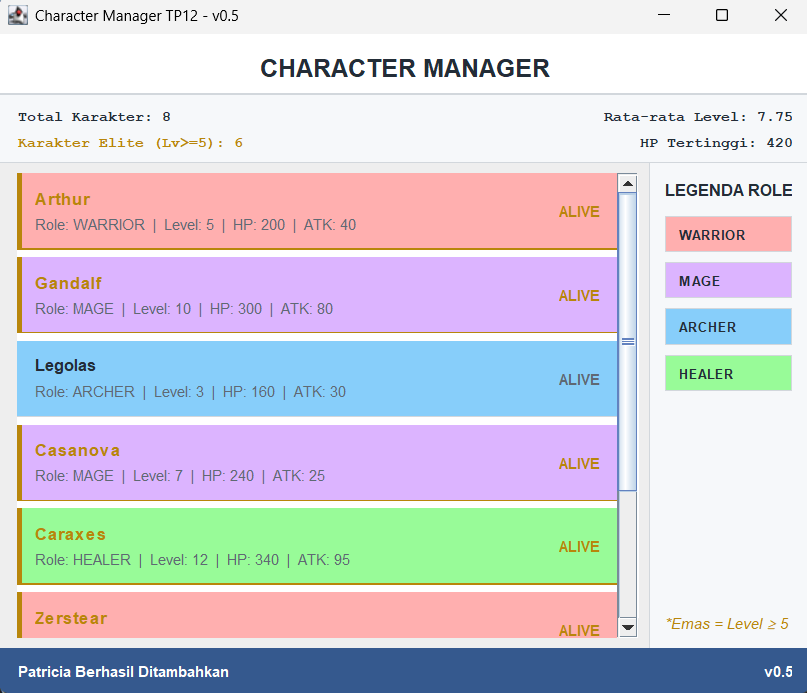
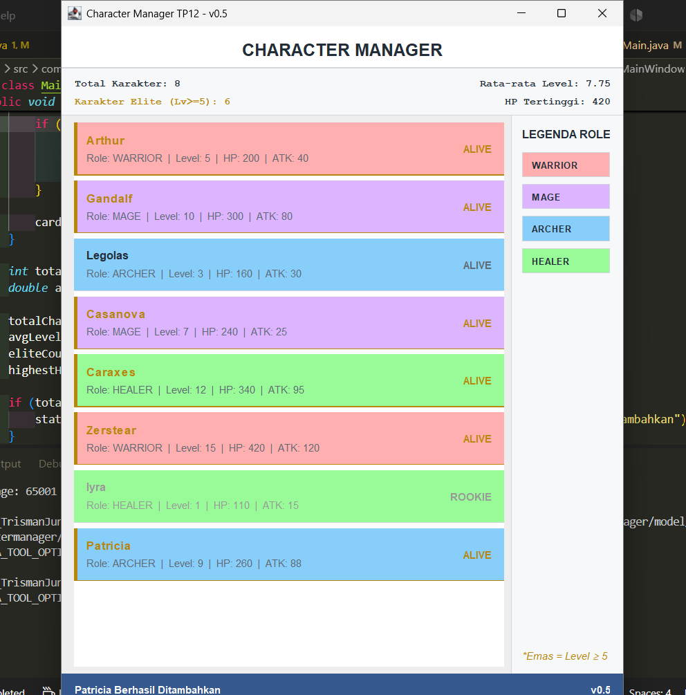
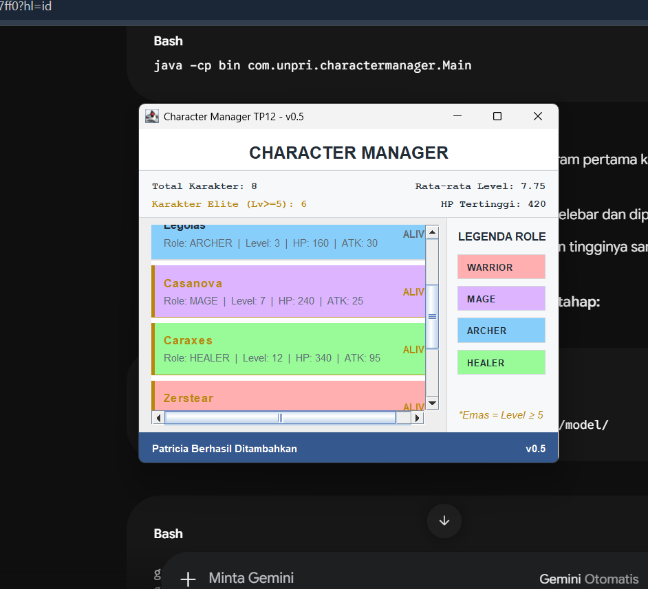

# JavaVisual_TrismanJunnedyEphaproditusGulo_253303621217

# Character Manager — TP3 (Java Visual SIH-6406)

Proyek ini merupakan implementasi fondasi *class model* Java untuk aplikasi **Character Manager** pada Sprint #1. Aplikasi ini dibangun mengimplementasikan konsep dasar Pemrograman Berbasis Objek (OOP) seperti *Encapsulation*, *Type Safety* dengan Enum, *Constructor Overloading*, serta validasi atribut kondisi (*exception handling*).

---

## 📌 Screenshot Output Terminal


---

## 📁 Struktur Folder Project

```text
javavisual-tp03-[NIM]/
├── README.md
└── CharacterManager/
    └── src/
        ├── Main.java
        └── com/
            └── unpri/
                └── charactermanager/
                    └── model/
                        ├── Character.java
                        └── CharacterType.java

```
---

# Character Manager Java Visual TP5

---
Nama: Trisman Junnedy Ephaproditus Gulo
NIM: 253303621217
Kelas: Sistem Informasi / Java Visual (SIH-6406)
Dosen Pengampu: Dr. Evta Indra


---


## Ringkasan Proyek
Proyek ini merupakan pengembangan lanjutan dari modul Character Manager (Sprint #2 / TP5). Fokus utama pengerjaan meliputi penerapan prinsip Pemrograman Berorientasi Objek di Java, validasi data, enkapsulasi memori, serta penanganan koleksi data secara aman.

---

## Struktur dan Implementasi Fitur
1. Core Implementation (Bagian A):
- Character.java: Mengimplementasikan method equals() yang dioverride untuk membandingkan kesamaan nama karakter secara case-insensitive.
- CharacterManager.java: Menyediakan method addCharacter() dengan pencegahan duplikasi nama, findByName(), removeCharacter(), getTotalCharacters(), serta getAllCharacters() yang menerapkan Defensive Copying agar list internal terlindungi dari modifikasi luar.

2. Mini-Challenge (Bagian B):
- getAverageLevel(): Menghitung rata-rata level seluruh karakter secara akurat dan dilengkapi pengaman kondisi list kosong (mencegah error pembagian dengan nol).
- findByType(CharacterType): Menyaring dan mengembalikan daftar karakter berdasarkan tipe tertentu.

3. Fitur Analitik Mandiri (Bagian C):
- renameCharacter(oldName, newName): Method rancangan sendiri untuk mengubah nama karakter dengan validasi ketat terhadap nama kosong dan pencegahan bentrok nama dengan karakter lain yang sudah ada.

## Analisis dan Dokumentasi (Bagian D)
- Tautan Dokumen Analisis Google Docs: https://docs.google.com/document/d/17mQVz4Sup2ySj154_-H6PZ7psDAkIZMqWyOgDwHO_bQ/edit?usp=sharing


## Screenshot Output Program


---

## TP8 — Character Manager Sprint #3 (MainWindow, Data Dinamis & MVC)

---

### 1. Aliran Data MVC (Main -> CharacterManager -> MainWindow)
Dalam arsitektur MVC yang diterapkan, kelas Main berperan sebagai Controller yang menginisialisasi objek CharacterManager (Model) beserta seluruh data karakter awal. Selanjutnya, Main menjalankan MainWindow (View) melalui SwingUtilities.invokeLater() dengan meneruskan referensi CharacterManager. MainWindow kemudian membaca salinan daftar karakter secara dinamis melalui perulangan (loop) untuk merender kartu komponen GUI dan memperbarui label statistik rata-rata level tanpa manipulasi data langsung.

### 2. Daftar Karakter Baru dan Alasan Pemilihan
- Mercy (Tipe: HEALER, Level: 7): Ditambahkan untuk melengkapi keragaman peran karakter pendukung (support) dan menguji tampilan dinamis dengan atribut mana yang tinggi.
- Shadow (Tipe: MAGE, Level: 12): Ditambahkan sebagai representasi karakter level tinggi guna menguji akurasi perhitungan rata-rata level pada label statistik di bagian bawah jendela.
- Ragnar (Tipe: WARRIOR, Level: 15): Digunakan pada pengujian kedua untuk membuktikan bahwa statistik rata-rata level otomatis berubah secara dinamis ketika data bertambah.

### 3. Link Dokumen Analisis GUI & MVC (Bagian D)
- Google Docs Analisis TP8: https://docs.google.com/document/d/1qUnXGoD2E3CNBsIdRjVAdcjbK1R4Dc9eFBOgiXzSOuU/edit?usp=sharing
(Akses dokumen diatur ke: Anyone with the link Viewer)

### 4. Screenshots MainWindow (Sebelum & Sesudah Perubahan Data)
- Screenshot 1 (5 Karakter — Rata-rata Level 7.40):
  
- Screenshot 2 (6 Karakter — Rata-rata Level 8.67):
  

  ---

  ## TP10 — Character Manager Sprint #4 (Theming, Properti Komponen & MVC)

  ---

### 1. Mengapa Warna Disimpan di AppTheme dan Bukan di Character?
Pengaturan warna disimpan di kelas AppTheme (layer View) dan bukan di dalam kelas Character (layer Model) untuk menjaga pemisahan tanggung jawab (Separation of Concerns) pada arsitektur MVC. Kelas Character hanya fokus mengelola data dan aturan bisnis karakter tanpa bergantung pada pustaka grafis java.awt.Color. Dengan demikian, tampilan tema visual dapat diubah secara terpusat di satu tempat tanpa harus menyentuh atau merusak struktur data pada package model.

### 2. Dua Properti Tambahan yang Dipilih dan Alasannya
- setToolTipText() pada Kartu Karakter: Menampilkan ringkasan lengkap seluruh atribut karakter (termasuk nilai Mana yang tidak ditampilkan di kartu utama) saat kursor diarahkan ke kartu, sehingga tampilan kartu tetap ringkas namun informatif.
- setEnabled(false) pada Karakter Level 1 (Rookie): Memberikan pembeda visual (efek teks redup) secara otomatis bagi karakter pemula yang masih berada di level 1 sebagai penanda status bahwa karakter tersebut belum siap diturunkan ke misi utama.

### 3. Link Dokumen Analisis Properti & MVC (Bagian D)
- Google Docs Analisis TP10: https://docs.google.com/document/d/1h79l414pdOZf5NFlvjPyC7lBw6iUGUz4GsD8T82VbNI/edit?usp=sharing
(Akses dokumen diatur ke: Anyone with the link Viewer)

### 4. Screenshots Perbandingan (Sebelum v0.3 vs Sesudah v0.4)
- Sebelum (MainWindow v0.3):
  
- Sesudah (MainWindow v0.4 dengan AppTheme & Highlight Emas Level >= 5):
  

  ## TP12 — Character Manager Sprint #5 (Layout, UI Responsif & Analisis MVC)

### 1. Wireframe Tata Letak (`MainWindow v0.5`)

```text
+-----------------------------------------------------------------------+
|                       CHARACTER MANAGER (Header)                      |  <- NORTH
| [Total Karakter: 8]                         [Rata-rata Level: 7.75]   |  <- GridLayout(2,2)
| [Karakter Elite (Lv>=5): 6]                     [HP Tertinggi: 420]   |
+---------------------------------------------------+-------------------+
| +-----------------------------------------------+ | LEGENDA ROLE      |
| | Arthur (WARRIOR - Merah Terang)         ALIVE | | [WARRIOR]         |
| +-----------------------------------------------+ | [MAGE]            |  <- EAST
| | Gandalf (MAGE - Ungu Terang)            ALIVE | | [ARCHER]          |     (BoxLayout
| +-----------------------------------------------+ | [HEALER]          |      Y_AXIS)
| | Legolas (ARCHER - Biru Terang)          ALIVE | |                   |
| +-----------------------------------------------+ | (Vertical Glue)   |
| | ... (JScrollPane berisi daftar kartu) ...     | | *Emas = Level >=5 |
+---------------------------------------------------+-------------------+
| Zerstear Berhasil Ditambahkan                                    v0.5 |  <- SOUTH
+-----------------------------------------------------------------------+

```
### 2. Struktur Panel Bersarang (Nested Panels)
Jendela utama `MainWindow` menggunakan `BorderLayout` sebagai kerangka utama dengan empat wilayah aktif (`NORTH`, `CENTER`, `EAST`, dan `SOUTH`). Wilayah `NORTH` berisi panel pembungkus `BorderLayout` yang menggabungkan judul aplikasi di atas dan panel statistik `GridLayout(2, 2)` di bawahnya. Wilayah `CENTER` menampung `JScrollPane` yang membungkus `scrollWrapperPanel` (`BorderLayout`), di mana `cardsGridPanel` (`GridLayout(0, 1)`) diletakkan pada posisi `NORTH` agar tinggi kartu karakter tetap proporsional dan tidak melar saat jendela diperbesar. Sementara itu, wilayah `EAST` menggunakan `BoxLayout` vertikal untuk legenda role, dan wilayah `SOUTH` memakai `BorderLayout` untuk memisahkan pesan status di kiri dan label versi `"v0.5"` di kanan.

### 3. Alasan Panel Tambahan dan Layout yang Ditolak
Panel tambahan yang dipilih adalah `GridLayout(2, 2)` di wilayah `NORTH` untuk menampilkan empat metrik ringkasan statistik karakter (Total Karakter, Rata-rata Level, Jumlah Karakter Elite, dan HP Tertinggi) dalam dua baris dan dua kolom yang sejajar rapi tanpa memakan banyak ruang vertikal. Sementara itu, `FlowLayout` ditolak untuk panel statistik ini karena `FlowLayout` akan membungkus komponen ke baris baru secara tidak teratur ketika jendela dikecilkan, sehingga merusak kesejajaran kolom statistik kiri dan kanan.

### 4. Tabel Pengamatan Resize (Prediksi vs Hasil)
| Kondisi Jendela | Prediksi Perilaku Layout | Hasil Aktual Saat Dijalankan |
| :--- | :--- | :--- |
| **Ukuran Awal (`pack()`)** | Jendela membuka sesuai ukuran ideal komponen; 4 wilayah `BorderLayout` terlihat lengkap dan seluruh kartu tertata rapi. | Sesuai prediksi. Jendela muncul pas di tengah layar dengan seluruh elemen terbaca jelas tanpa ruang kosong berlebih. |
| **Jendela Dilebarkan & Dipertinggi** | Wilayah `CENTER` melebar ke samping mengikuti lebar jendela, tinggi kartu tetap stabil (tidak melar), dan `EAST` tetap selebar legenda. | Sesuai prediksi. Kartu melebar secara horizontal dengan rapi, tinggi kartu tetap proporsional berkat pembungkus `BorderLayout.NORTH`, dan legenda tetap merapat ke atas karena *vertical glue*. |
| **Jendela Dikecilkan (Tinggi Dikurangi)** | `NORTH`, `SOUTH`, dan `EAST` tetap bertahan pada ukuran aslinya, sementara `CENTER` menyusut dan memunculkan *scrollbar* vertikal. | Sesuai prediksi. Header, statistik, dan bar status tidak terpotong, sedangkan daftar kartu di tengah otomatis memunculkan *scrollbar* untuk menggulir karakter ke bawah. |

### 5. Link Dokumen Analisis Layout & MVC (Bagian D)
Google Docs Analisis TP12: https://docs.google.com/document/d/1HfP8PnjSwDrjxAJ1-bG8nqeJo_hy3RHBwxiR2OKHX2U/edit?usp=sharing
### 6. Screenshots Pengujian Responsivitas (v0.5)
**Ukuran Awal (`pack()`):**


**Jendela Dilebarkan:**


**Jendela Dikecilkan (Scrollbar Muncul):**
